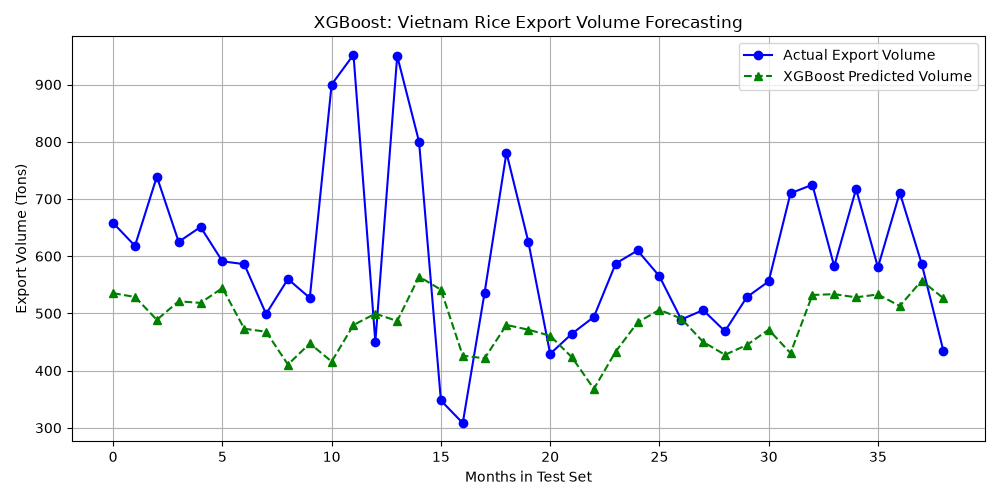

# Rice Export Forecasting

Forecasting Vietnam's monthly rice export volume from economic, climate, and competitor data. The project compares three models side by side:

- **LSTM** (PyTorch): multivariate recurrent network
- **GRU** (PyTorch): multivariate recurrent network with a lighter gated cell
- **XGBoost**: gradient-boosted trees on engineered lag and rolling features

Each script trains its model, prints test-set RMSE and MAE, and saves an *Actual vs Predicted* chart to [Results/](Results/).

## Dataset

All three models use [rice_data.csv](rice_data.csv), which has 207 monthly rows from **January 2005 to December 2022**.

Columns:

| Column | Description |
|---|---|
| `Month` | Observation month |
| `Vietnam Exporting Volume (Tons)` | **Target**: Vietnam's rice export volume |
| `Vietnam Rice export Value (Mill. USD)` | Export value |
| `Exchange Rate (thousand VND/Dollar)` | VND/USD exchange rate |
| `Hour of Sunlight (Hour)` | Monthly sunlight hours |
| `Average Temperature (Celcius)` | Average temperature |
| `Average Moisture ( )` | Average humidity |
| `Average Rainfall (mm)` | Average rainfall |
| `Thailand (Value)` | Thailand's rice export value (main competitor) |
| `Thailand (Volume)` | Thailand's rice export volume |

## Models

### LSTM and GRU ([LSTM.py](LSTM.py), [GRU.py](GRU.py))

Both recurrent models use the same pipeline:

- **Features (5):** export volume, exchange rate, average temperature, average rainfall, Thailand's export volume
- **Scaling:** `MinMaxScaler` on all features. A separate scaler on the target converts predictions back to tons.
- **Sequences:** a sliding window of **6 months** predicts the next month's volume
- **Split:** 80% train / 20% test, kept in time order (no shuffling)
- **Architecture:** 2 stacked recurrent layers (hidden size 32) followed by a linear output layer
- **Training:** Adam (lr = 0.01), MSE loss, 150 full-batch epochs

### XGBoost ([XGBoost.py](XGBoost.py))

Tree models can't read sequences directly, so time information is turned into tabular features:

- **Calendar features:** month number, quarter, year
- **Lag features:** export volume lagged by 1, 2, 3, 6 and 12 months
- **Rolling means:** 3-month and 6-month moving averages of past volume
- **Exogenous features:** exchange rate, sunlight, temperature, humidity, rainfall, Thailand's value and volume
- **Model:** `XGBRegressor(n_estimators=100, max_depth=3, learning_rate=0.05, subsample=0.8, colsample_bytree=0.8)`
- **Split:** 80% train / 20% test in time order

The script also prints the 5 most important features.

> The `Month` column in `rice_data.csv` contains spreadsheet-mangled dates (e.g. `1/5/2026` for Jan 2005), so the script rebuilds the dates from row order, starting January 2005.

## Results

Charts compare actual and predicted export volume over the test months:

<p align="center">
  
  <br><em>Multivariate LSTM</em>
</p>

<p align="center">
  
  <br><em>Multivariate GRU</em>
</p>

<p align="center">
  
  <br><em>XGBoost</em>
</p>

| Model | Test RMSE (tons) | Test MAE (tons) |
|---|---|---|
| **GRU** | **151.16** | **109.24** |
| LSTM | 156.66 | 116.61 |
| XGBoost | 186.22 | 143.24 |

GRU scores best on both metrics, with LSTM close behind. XGBoost trails them. Its most important features are the 12‑month and 1‑month volume lags, which shows how strongly yearly seasonality and last month's volume drive exports.

_All runs use a fixed random seed (42), so these scores are reproducible._

## Getting Started

### Requirements

- Python 3.9+
- `pandas`, `numpy`, `scikit-learn`, `matplotlib`, `torch`, `xgboost`

```bash
pip install pandas numpy scikit-learn matplotlib torch xgboost
```

### Run

Run each script from the project root so the relative paths to `rice_data.csv` and `Results/` resolve:

```bash
python LSTM.py
python GRU.py
python XGBoost.py
```

Each script prints its RMSE and MAE and writes its chart to `Results/`. `LSTM.py` and `GRU.py` also open the chart in a window.

## Project Structure

```
Rice-Export-Forecasting/
├── LSTM.py           # Multivariate LSTM (PyTorch)
├── GRU.py            # Multivariate GRU (PyTorch)
├── XGBoost.py        # XGBoost with lag/rolling features
├── rice_data.csv     # Monthly dataset (Jan 2005 – Dec 2022), used by all models
└── Results/          # Saved prediction charts
```

## Notes

- LSTM and GRU set `torch.manual_seed(42)` and `np.random.seed(42)`, and XGBoost uses `random_state=42`, so repeated runs give the same scores. Change the seed to see how much results vary with initialization.
- The scalers are fit on the full dataset before the train/test split, so a little information from the test period leaks into training. Fitting them on the training portion only would give a stricter evaluation.
